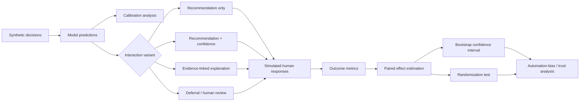
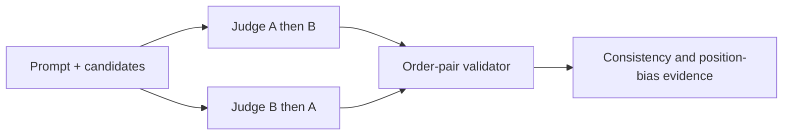

# Responsible AI Interaction Lab

A small experimental framework for studying how **confidence, explanations and human review design** change the way people interact with AI recommendations.

This repository focuses on an easily overlooked problem:

> A model can be technically accurate while the surrounding interface still encourages bad decisions.

The lab therefore treats interaction design as part of model risk.

## Questions explored

- Does showing a numeric confidence score make reviewers over-trust the model?
- Do evidence-linked explanations improve review quality compared with generic rationales?
- When should a system defer instead of presenting a strong recommendation?
- How often do reviewers override the AI, and are overrides concentrated in low-confidence cases?
- Does an explanation increase agreement even when the recommendation is wrong?
- How does calibration affect a policy threshold for automation?
- Does an LLM judge keep the same candidate preference when response order is swapped?

## Experiment architecture



Pairwise LLM-judge observations also have a separate counterbalanced audit path:



## Core metrics

- model accuracy;
- expected calibration error (ECE);
- Brier score;
- human accuracy;
- AI-human agreement rate;
- override rate;
- **harmful agreement rate** — human agrees when AI is wrong;
- beneficial override rate — human corrects an AI error;
- harmful override rate — human changes a correct AI answer into a wrong one;
- deferral rate;
- accuracy after deferral;
- explanation-induced agreement delta.

## Paired experiment design

The original aggregate comparison ran baseline and treatment with unrelated random
reviewer draws. That can make ordinary simulation noise look like an interface effect.
The paired evaluator instead derives a stable random stream from each case ID and
experiment seed, then evaluates both variants against the same latent reviewer draw.

For human accuracy, harmful agreement and beneficial override, the report includes:

- baseline and treatment means;
- the paired absolute effect;
- a percentile bootstrap confidence interval;
- a two-sided paired sign-flip randomization p-value;
- the number of matched cases.

Case-level seeds do not depend on input order or Python's randomized string hash.
Duplicate case IDs are rejected because they would violate the matched-unit contract.
These statistics quantify uncertainty in the synthetic experiment only; they are not
presented as findings about real reviewers.

## Pairwise LLM-judge order audit

The `POST /judge/order-bias` endpoint accepts externally produced pairwise judge
results. Every case must contain exactly one `ab` run and one `ba` run. The audit
maps positional winners back to candidate identity and reports:

- candidate-consistent pairs, where the same candidate wins after the swap;
- position-driven pairs, where the same position wins and the selected candidate changes;
- tie-consistent and mixed-tie pairs without coercing ties into preferences;
- a 95% Wilson interval for the position-driven rate among non-tie pairs;
- an exact two-sided binomial test for first- versus second-position direction among
  position-driven pairs.

Incomplete or duplicate order pairs fail closed with a validation error. The audit
does not call or score an LLM itself: it evaluates recorded outputs, so model name,
prompt template, decoding parameters and raw responses should be versioned by the
calling evaluation system.

## Interaction variants

### Recommendation only

The reviewer sees only the proposed action.

### Confidence

The reviewer sees the action and a confidence estimate. This may improve uncertainty awareness, but it can also create anchoring.

### Evidence-linked explanation

The reviewer sees the recommendation plus the evidence IDs and reason codes that support it.

### Deferral

If model confidence or policy conditions fail a threshold, the interface does not present a strong automated recommendation and routes the case for human judgment.

## Repository layout

```text
responsible-ai-interaction-lab/
├── experiment.py       # calibration, interaction simulation and aggregate metrics
├── evaluation.py       # matched responses, effect estimates, bootstrap and tests
├── judge_audit.py      # counterbalanced pairwise LLM-judge order audit
├── app/api.py          # calibration, interaction and paired-comparison HTTP API
├── tests/              # deterministic metric, pairing, API and edge-case coverage
└── README.md
```

## Run

```bash
python experiment.py
```

The API exposes `POST /synthetic/paired-compare` for a reproducible matched
baseline/treatment report and `POST /judge/order-bias` for counterbalanced judge
consistency evidence.

The demo produces synthetic probabilities and reviewer responses only. It is intended to demonstrate evaluation methodology, not to claim human-subject research results.

## Portfolio signal

**Responsible AI · LLM Evaluation · Human Factors · Calibration · Human-in-the-loop · Automation Bias · Explainability · Experiment Design · AI Product Evaluation**
